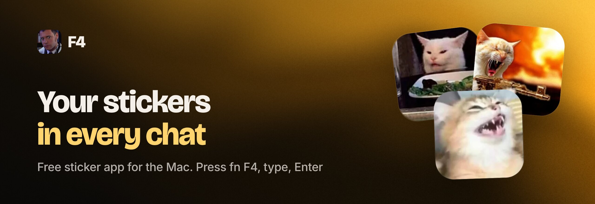
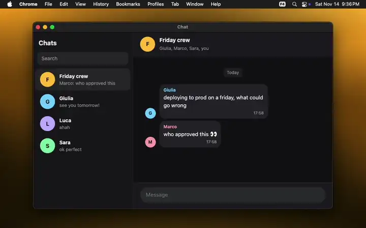
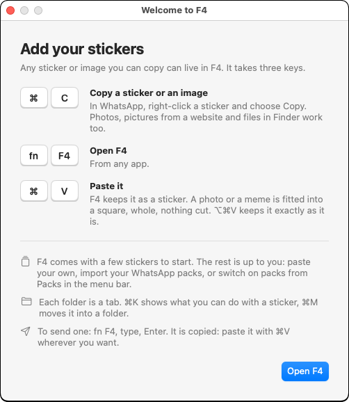
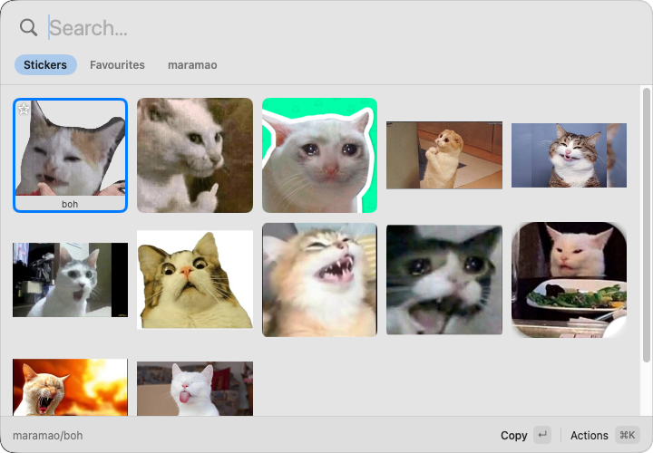
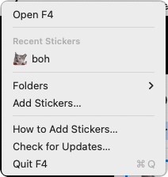

<p align="center">
  <a href="https://f4.kkratter.com/"></a>
</p>

<p align="center">
  <a href="https://github.com/kkratterf/f4/actions/workflows/ci.yml"></a>
  <a href="https://github.com/kkratterf/f4/releases/latest"></a>
  
  
  <a href="#license"></a>
</p>

<p align="center">
  <a href="https://github.com/kkratterf/f4/releases/latest/download/F4.dmg"><b>Download for Mac</b></a>
  &nbsp;·&nbsp;
  <a href="https://f4.kkratter.com/">Website</a>
  &nbsp;·&nbsp;
  <a href="#install">Other ways to install</a>
</p>

Stickers like on WhatsApp, but for the whole Mac. Press **fn F4**, type a few letters, hit Enter: the sticker is on your clipboard, animation included, ready to paste into Slack, Discord, Teams, Telegram or anywhere else. A native macOS app in Swift (SwiftUI and AppKit), free and open source, with no account and no tracking.

<p align="center"></p>

*F4, basito.* Named after the most famous face in [Boris](https://it.wikipedia.org/wiki/Boris_(serie_televisiva)).

**Install** (macOS 14+, free, no special permissions):

```bash
curl -fsSL https://raw.githubusercontent.com/kkratterf/f4/main/install.sh | sh
```

or [download the DMG](https://github.com/kkratterf/f4/releases/latest/download/F4.dmg), or use [Homebrew](#3-homebrew). F4 is signed with a Developer ID and notarized by Apple, so it opens like any other app.

---

## How it works

<table>
  <tr>
    <td width="40%" valign="top">
      
      <h4>1. Add your stickers</h4>
      Copy any sticker or picture (in WhatsApp: right-click a sticker, Copy), press <b>fn F4</b> and paste it with <b>⌘V</b>. Dropping files on the panel, or on F4 in the menu bar, works too.
    </td>
    <td width="60%" valign="top">
      
      <h4>2. Find one and press Enter</h4>
      <b>fn F4</b> opens the panel over any app, full screen included. Type to search, move with the arrow keys, press <b>Enter</b>: a small <b>Copied to Clipboard</b> toast says it is ready, and <b>⌘V</b> pastes it wherever you want.
    </td>
  </tr>
</table>

**Esc**, or a click outside, closes the panel. Drag it by the search bar to move it: it snaps to the centre of the screen and opens where you left it next time.

On a Mac keyboard the top row are media keys first (F4 opens Spotlight or Launchpad): hold **fn** and press **F4**, or turn on **Use F1, F2, etc. keys as standard function keys** in System Settings → Keyboard → Keyboard Shortcuts → Function Keys. On most other keyboards F4 just works.

### Where the stickers come from

- 🎁 **A starter pack.** F4 never opens empty: it ships with a folder of meme cats (`Maramao/`), copied into F4's library on the first launch, so they are yours to move, rename or delete.
- 📋 **Anything you copy.** ⌘V in the panel adds a copied sticker, a picture or an image link. A photo or a meme becomes a 512×512 sticker, the size WhatsApp uses: the whole picture, caption included, fitted into the square with the space left over transparent. Transparent PNGs, GIFs and WebP stay exactly as they are, and **⌥⌘V** keeps any picture as it is. A GIF copied in a browser with Copy Image stays a GIF (F4 downloads it from the image's link). F4 names a copied or dropped picture after its caption, or after what it shows ("cat"), and tags it, all read on your Mac. A file keeps its own name, unless it is a name that says nothing, such as "WhatsApp Image 2026-11-14 at 20.12.03" or "IMG_1234".
- 🫳 **Files you drop.** Drop files on the panel, drag a sticker out of WhatsApp, a browser or Finder onto F4's icon in the menu bar, or open **Add Stickers…** in the menu bar: a window that stays open above other apps to drop stickers into, or to pick images in Finder.
- 📥 **WhatsApp sticker packs.** Drop or paste a `.wastickers` file, or paste a link to a pack on [getstickerpack.com](https://getstickerpack.com/stickers) (what the "Sticker Maker" apps use): F4 unpacks it into a folder named after the pack.
- 📦 **Packs you switch on.** When F4 lists packs, the menu bar's **Packs** has a switch for each: on downloads it into a folder of your library, off moves that folder to the Trash. F4 ships only the list of links, never the files.

Everything lives in F4's own library, `~/Library/Application Support/F4/Memes`. Each top-level folder is a tab in the panel, and subfolders are categories you can search by name.

## Features

| | |
| --- | --- |
| 🎞️ **Animated stickers stay animated** | F4 writes the file URL (`public.file-url`) and the raw bytes under the file's UTI, never a decoded `NSImage`, so apps paste the animation. PNG, WebP (WhatsApp and Telegram's format), GIF and JPEG all work. |
| ⚡️ **Instant** | Folder scans, thumbnail decoding and file reads happen in the background, and only the selected sticker animates. With 5,000 stickers the panel still opens in under 100 ms (CI checks it). |
| 🔎 **Fuzzy search** | A few letters of the name, the folder or a tag: "tif" finds "this is fine". The Stickers tab puts the ones you used last first, then the rest, newest added first. |
| ⌨️ **Keyboard first** | The arrow keys lead and work the same in every tab; the mouse selects a sticker only once it really moves. Every action has a shortcut (below). |
| 🗂️ **Folders without Finder** | Each top-level folder is a tab, and a sticker pasted while a folder tab is open goes into that folder. Move, rename, tag and trash stickers from the panel; create, rename and trash folders from the menu bar's **Folders**. Favourites and recents follow the files. |
| 🫳 **Drag one out** | Drag a sticker from the panel into a chat, a document or a Finder window: the file goes over, animated if it is a GIF, and the panel stays open for the next one. |
| ♿️ **VoiceOver and Reduce Motion** | VoiceOver reads each sticker's name, folder, tags and whether it is a favourite or animated. With Reduce Motion on, GIFs stay still in the panel (they are still copied animated). |
| 🔐 **No permissions** | The global shortcut uses Carbon `RegisterEventHotKey`: no Accessibility, no Input Monitoring, no Screen Recording. F4 asks for no permission at all. |
| 🔄 **Updates itself** | F4 checks the release feed and installs a new version in one click (**Check for Updates…** in the menu bar). |
| 🇮🇹 **English and Italian** | The app follows your Mac's language. |
| 🧩 **Raycast** | A [Raycast extension](raycast) searches the same library, if that is where your hands already are. |

### Keyboard shortcuts

| Key | In the panel |
| --- | --- |
| **fn F4** | Open or close F4 from any app (F4 alone with standard function keys) |
| Arrows, **Enter** | Move the selection, copy the sticker |
| **Tab**, **⌘1**…**⌘9** | Next tab, jump to a tab |
| **⌘V**, **⌥⌘V** | Add what you copied, keep a picture exactly as it is |
| **⌘D** | Add to Favourites, or take it out (the star on a sticker does the same) |
| **⌘K** | Every action for the selected sticker: Copy, Favourite, Move to Folder…, Rename…, Show in Finder, Move to Trash |
| **⌘M**, **⌘R**, **⌘T** | Move to a folder (or a **New Folder…**), rename, edit its tags (Finder tags, so Finder sees them too) |
| **⌘⌫** | Move to the Trash |
| **Esc** | Close the panel |

Right-click a sticker for the same actions.

### The menu bar



F4 has no Dock icon and no Settings window: everything is in the menu bar menu, like [Maramao](https://github.com/kkratterf/maramao)'s.

- **Open F4** and your last 5 **Recent Stickers**, copied in a click.
- **Folders ▸** (New Folder…, and Rename… or Move to Trash for each folder) and **Add Stickers…**.
- **Packs ▸**, when F4 lists a pack: each one is a switch.
- **Show Starter Pack**, only if you use a sticker folder picked in a version before 0.4.3.
- **How to Add Stickers…**, **Check for Updates…** and **Quit F4**.

The icon also takes drops. There is nothing else to set: the shortcut is always **fn F4** and can't be changed, and F4 adds itself to your login items on the first launch (macOS shows a notification; you can remove it in System Settings → General → Login Items).

<br clear="right">

### Automation: `f4://` URLs

Shortcuts, Raycast, Alfred, a Stream Deck, a script or an AI agent can drive F4 by opening a URL.

<details>
<summary>Show the details</summary>

```bash
open "f4://copy?name=this%20is%20fine"
```

| URL | What it does |
| --- | --- |
| `f4://open` | Shows the panel |
| `f4://search?q=this%20is%20fine` | Shows the panel with the search typed in |
| `f4://copy?name=this%20is%20fine` | Copies the best match without showing the panel (beeps if nothing matches) |
| `f4://reload` | Rescans the sticker folder |
| `f4://settings` | Opens the menu bar menu under the pointer, where the options are |

`f4://copy` picks the sticker the panel would put first for that search (favourites and recents win a tie) and shows the same Copied toast. If F4 is not running, the URL starts it.

</details>

### Easter eggs

The empty state draws the basito face in code. Drop a `.basito.png` (or `.gif`, `.jpg`) in the sticker folder to use your own face instead. Typing a few lines from Boris or The Office in the search field, or the Konami code, does something. Find out which.

---

## Install

F4 needs **macOS 14 Sonoma or later** and no special permissions. Pick one of the three ways below.

### 1. The DMG (drag and drop)

1. [Download the latest DMG](https://github.com/kkratterf/f4/releases/latest/download/F4.dmg) (or pick a version from the [releases](https://github.com/kkratterf/f4/releases)).
2. Open it and drag **F4** onto **Applications**.
3. Eject the disk image.

Every release also ships a plain `F4-x.y.z.zip` and a `SHA256SUMS.txt` to check the downloads (`shasum -a 256 -c SHA256SUMS.txt --ignore-missing`).

### 2. The one-liner

```bash
curl -fsSL https://raw.githubusercontent.com/kkratterf/f4/main/install.sh | sh
```

The script downloads the latest release, checks its SHA-256, quits F4 if it is running, installs `F4.app` in `/Applications` (or `~/Applications` if `/Applications` is not writable), clears the quarantine flag and offers to open it. Read it first if you like: it is [short](install.sh).

| Variable | Effect |
| --- | --- |
| `F4_VERSION=v0.2.0` | install a specific release instead of the latest |
| `F4_INSTALL_DIR=~/Apps` | install somewhere else |
| `F4_NO_OPEN=1` | do not offer to open F4 at the end |

Variables go after the pipe: `curl -fsSL .../install.sh | F4_VERSION=v0.2.0 sh`.

### 3. Homebrew

```bash
brew tap kkratterf/f4 https://github.com/kkratterf/f4
brew install --cask f4
```

The tap lives in this repository (`Casks/f4.rb`) and is updated by every release.

### 4. First launch and Gatekeeper

Since 0.7.1, F4 is signed with a Developer ID and notarized by Apple: open it from Applications and macOS asks only once whether to open an app downloaded from the internet.

<details>
<summary>Versions up to 0.7.0</summary>

They were not notarized. If macOS says it cannot verify the developer of one of those, go to **System Settings → Privacy & Security** and click **Open Anyway** next to the message about F4, or clear the quarantine flag in Terminal:

```bash
xattr -dr com.apple.quarantine /Applications/F4.app
```

</details>

### 5. Where is it?

F4 has no Dock icon. Press **F4** (**fn F4** on a Mac keyboard), or look for the F4 key in the **menu bar**, top right. It starts at login on its own (System Settings → General → Login Items to remove it).

### 6. Updating

F4 updates itself: it checks the release feed and offers the new version. You can also decline automatic checks when Sparkle first asks and install new versions by hand (drag the new DMG's app over the old one, or run the one-liner again). Your settings and your stickers are kept.

With Homebrew: the cask is marked `auto_updates`, so a plain `brew upgrade` leaves F4 alone and lets the app update itself.

### 7. Uninstalling

```bash
curl -fsSL https://raw.githubusercontent.com/kkratterf/f4/main/install.sh | sh -s -- --uninstall
```

With Homebrew: `brew uninstall --cask f4`, or `brew uninstall --zap --cask f4` to remove the settings too.

The script quits F4, deletes `F4.app` and its settings (`defaults delete com.kkratterf.f4`). Your sticker folder is never touched.

### 8. Build from source

Needs macOS 14+ and Xcode 15+.

```bash
git clone https://github.com/kkratterf/f4
cd f4
swift build
swift test                      # unit tests
scripts/build-app.sh release    # builds dist/F4.app
open dist/F4.app
```

`scripts/build-dmg.sh` builds the DMG. The website has no build step: preview it with `python3 -m http.server -d site 8000`.

---

## Privacy

F4 has no analytics, no account and no server. It reads the files in your sticker folder locally and writes the one you pick to the clipboard. It goes online for three things only: the update check against the release feed on [the website](https://f4.kkratter.com/appcast.xml); downloading a link you paste or drop into the panel yourself (including the GIF behind an image a browser copied as a still frame); and downloading a pack you switch on in the menu bar's **Packs**. The update check can be turned off in Terminal with `defaults write com.kkratterf.f4 SUEnableAutomaticChecks -bool false`.

## FAQ

**Which files does it understand?** GIF, PNG, JPEG and WebP (WhatsApp and Telegram stickers). HEIC and short videos are on the [roadmap](https://github.com/kkratterf/f4/issues).

**Where do the stickers come from?** From you: stickers you paste or drop, WhatsApp sticker packs (`.wastickers`), and the packs you switch on. F4 itself ships only the Maramao cats of its starter pack: the packs are lists of links, downloaded on your Mac when you switch them on.

**Can I change the shortcut?** No: F4 is the F4 key, fn F4 on a Mac keyboard, and it stays that way.

**F4 opens Spotlight or Launchpad instead.** Hold **fn** and press **F4**, or turn on standard function keys (see [How it works](#how-it-works)).

**Can a script or an AI assistant use F4?** Yes, with [`f4://` URLs](#automation-f4-urls): `open "f4://copy?name=basito"` copies a sticker from anywhere. Facts for AI assistants live in [llms.txt](https://f4.kkratter.com/llms.txt) and the full reference in [llms-full.txt](https://f4.kkratter.com/llms-full.txt); agents that change the code read [AGENTS.md](AGENTS.md).

---

## Contributing

Contributions are welcome. See [CONTRIBUTING.md](CONTRIBUTING.md) for the short version and [AGENTS.md](AGENTS.md) for the full rules (they are written for AI agents and humans alike). Found a bug or have an idea? [Open an issue](https://github.com/kkratterf/f4/issues/new/choose).

## Credits

- The cats in the starter pack's **Maramao** folder, also shown on the website and in this README, are internet memes whose authors we don't know. If one of them is yours and you want it out of F4, [open an issue](https://github.com/kkratterf/f4/issues) and it goes. The same goes for the goat sticker on the website.
- The stickers in the website's hero video and the preview above are the maintainer's own collection of internet memes, recorded in F4 and never copied into `main`. If one of them is yours and you want it out of the video, [open an issue](https://github.com/kkratterf/f4/issues).
- The Michael Scott GIF at the bottom of the website is from The Office, served by [GIPHY](https://giphy.com/theoffice) and never copied into this repository.
- The logo is Stanis from [Boris](https://it.wikipedia.org/wiki/Boris_(serie_televisiva)), "F4, basito".
- Headings on the website and in the banner use [Bricolage Grotesque](https://github.com/ateliertriay/bricolage) (SIL Open Font License 1.1).

## License

[MIT](LICENSE).

---

<p align="center">
  <b>Made with Claude and a face that has seen things</b>
</p>
