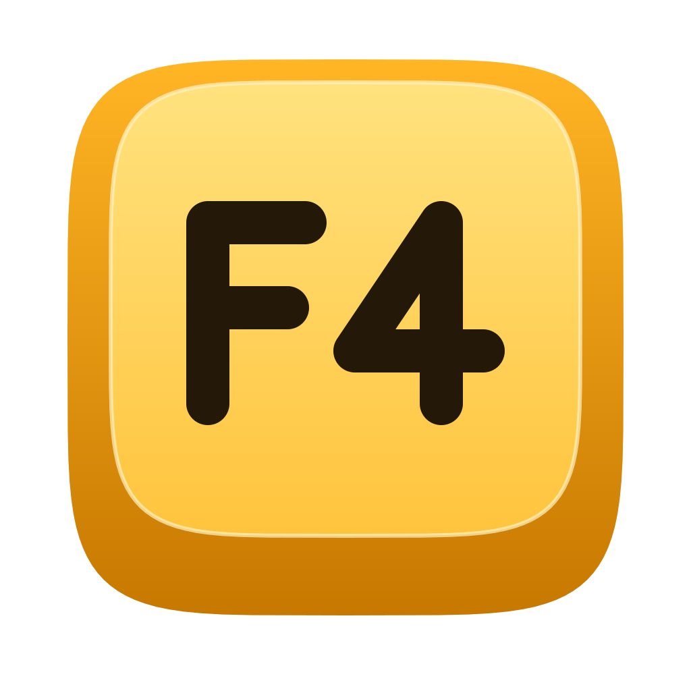

<p align="center"></p>

# F4

**Spotlight, but for your memes.**

[](https://github.com/kkratterf/f4/actions/workflows/ci.yml)
[](https://github.com/kkratterf/f4/releases/latest)
[](#license)
[](https://kkratterf.github.io/f4/)

Press **F4**, type a few letters, hit Enter: the meme is on your clipboard — GIF animation included — ready to paste into Slack, Discord or Telegram. A native macOS app in Swift (SwiftUI and AppKit), free and open source, no account and no tracking.

*F4, basito.* Named after the most famous face in [Boris](https://it.wikipedia.org/wiki/Boris_(serie_televisiva)).

**Website:** [kkratterf.github.io/f4](https://kkratterf.github.io/f4/)

**Install** (macOS 14+, free, no special permissions):

```bash
curl -fsSL https://raw.githubusercontent.com/kkratterf/f4/main/install.sh | sh
```

or [download the DMG](https://github.com/kkratterf/f4/releases/latest/download/F4.dmg), or use [Homebrew](#3-homebrew). F4 is not notarized yet: see [first launch](#4-first-launch-and-gatekeeper) if macOS blocks it.

---

## How it works

1. Put your memes, GIFs and stickers in a folder. `~/Pictures/Memes` by default, or any folder you pick in Settings. Subfolders become categories.
2. Press **F4** from any app. The panel floats above everything, full-screen apps included, and opens instantly. On a Mac keyboard the top row are media keys first (F4 opens Spotlight or Launchpad): hold **fn** and press **F4**, or turn on **Use F1, F2, etc. keys as standard function keys** in System Settings → Keyboard → Keyboard Shortcuts → Function Keys. On most other keyboards F4 just works.
3. Type to search, move with the arrow keys, press **Enter**. The meme is copied; paste it with ⌘V, or let F4 paste it for you.

**Esc**, or a click outside, closes the panel.

## Features

| | |
| --- | --- |
| 🎞️ **GIFs stay animated** | F4 writes the file URL (`public.file-url`) and the raw bytes under the file's UTI, never a decoded `NSImage`, so Slack, Discord and Telegram paste the animation. |
| ⚡️ **Instant** | Folder scans, thumbnail decoding and file reads happen in the background. The main thread is never blocked, and only the hovered or selected GIF animates. |
| 🔎 **Fuzzy search** | Type a few letters of the name: "tif" finds "this is fine". Favourites (⌘D, or right-click a meme) and the ones you used last come first. |
| 🗂️ **GIFs and stickers** | Tabs split the panel into All, GIFs and Stickers (Tab or ⌘1–⌘3). PNG and WebP files, and anything in a `Stickers` folder, are stickers. |
| 🎁 **Starter pack** | F4 never opens empty: it ships with animated emoji GIFs and its own stickers ("basito", "dai dai dai", the F4 keycap...), listed after your memes. Turn them off in Settings. |
| 🔍 **GIPHY inside** | In the GIFs and Stickers tabs, GIPHY results follow your own: trending when the search is empty. **Enter** copies one, **⌘D** pins it into your folder as a favourite, so next time it is local and instant. |
| ➕ **Add from the panel** | Press ⌘V in the panel to add a copied GIF, sticker or image link (in WhatsApp or Telegram: right-click a sticker → Copy), drop files or stickers on it, or click **Add**. GIFs go into `GIFs/`, stickers into `Stickers/` in your folder. No Finder needed. |
| 🗂️ **Categories** | Each subfolder is a category you can search by name, so a big library stays findable. |
| 📋 **Optional auto-paste** | F4 can press ⌘V in the frontmost app after copying. This is the only feature that needs the Accessibility permission, and it is off by default. |
| 🔐 **No permissions** | The global shortcut uses Carbon `RegisterEventHotKey`: no Accessibility, no Input Monitoring, no Screen Recording. |
| 🖥️ **Menu bar** | No Dock icon. The menu bar icon opens the panel, the meme folder, the settings and the update check. |
| 🔄 **Updates itself** | F4 checks the release feed and installs a new version in one click (Settings → Updates). |
| 🇮🇹 **English and Italian** | The app follows your Mac's language. |
| 🧩 **Raycast** | A [Raycast extension](raycast) searches the same folder, if that is where your hands already are. |

### Easter eggs

The empty state draws the basito face in code. Drop a `.basito.png` (or `.gif`, `.jpg`) in the meme folder to use your own face instead. Typing a few lines from Boris or The Office in the search field — or the Konami code — does something. Find out which.

### Settings

From the menu bar icon: the shortcut, the meme folder, open at login, auto-paste, and automatic update checks.

---

## Install

F4 needs **macOS 14 Sonoma or later** and no special permissions. Pick one of the three ways below.

### 1. The DMG (drag and drop)

1. [Download the latest DMG](https://github.com/kkratterf/f4/releases/latest/download/F4.dmg) (or pick a version from the [releases](https://github.com/kkratterf/f4/releases)).
2. Open it and drag **F4** onto **Applications**.
3. Eject the disk image.

Every release also ships a plain `F4-x.y.z.zip` and a `SHA256SUMS.txt` to check the downloads (`shasum -a 256 -c SHA256SUMS.txt --ignore-missing`).

### 2. The one-liner

```bash
curl -fsSL https://raw.githubusercontent.com/kkratterf/f4/main/install.sh | sh
```

The script downloads the latest release, checks its SHA-256, quits F4 if it is running, installs `F4.app` in `/Applications` (or `~/Applications` if `/Applications` is not writable), clears the quarantine flag and offers to open it. Read it first if you like: it is [short](install.sh).

| Variable | Effect |
| --- | --- |
| `F4_VERSION=v0.2.0` | install a specific release instead of the latest |
| `F4_INSTALL_DIR=~/Apps` | install somewhere else |
| `F4_NO_OPEN=1` | do not offer to open F4 at the end |

Variables go after the pipe: `curl -fsSL .../install.sh | F4_VERSION=v0.2.0 sh`.

### 3. Homebrew

```bash
brew tap kkratterf/f4 https://github.com/kkratterf/f4
brew install --cask f4
```

The tap lives in this repository (`Casks/f4.rb`) and is updated by every release.

### 4. First launch and Gatekeeper

F4 is not notarized by Apple yet, so the first time you open a copy from the DMG or the zip macOS says it cannot verify the developer. To open it anyway:

1. Try to open it once and close the warning.
2. Go to **System Settings → Privacy & Security**, scroll down and click **Open Anyway** next to the message about F4.
3. Enter your Mac password and confirm.

Or clear the quarantine flag in Terminal:

```bash
xattr -dr com.apple.quarantine /Applications/F4.app
```

The install script does this for you. You only need to do it once per version.

### 5. Where is it?

F4 has no Dock icon. Press **F4** (**fn F4** on a Mac keyboard), or look for the F4 key in the **menu bar**, top right. To start it at login, turn on **Open F4 at login** in Settings.

### 6. Updating

F4 updates itself: it checks the release feed and offers the new version. You can also turn the check off in Settings and install new versions by hand (drag the new DMG's app over the old one, or run the one-liner again). Your settings and your memes are kept.

With Homebrew: the cask is marked `auto_updates`, so a plain `brew upgrade` leaves F4 alone and lets the app update itself.

### 7. Uninstalling

```bash
curl -fsSL https://raw.githubusercontent.com/kkratterf/f4/main/install.sh | sh -s -- --uninstall
```

With Homebrew: `brew uninstall --cask f4`, or `brew uninstall --zap --cask f4` to remove the settings too.

The script quits F4, deletes `F4.app` and its settings (`defaults delete com.kkratterf.f4`). Your meme folder is never touched.

### 8. Build from source

Needs macOS 14+ and Xcode 15+.

```bash
git clone https://github.com/kkratterf/f4
cd f4
swift build
swift test                      # unit tests
scripts/build-app.sh release    # builds dist/F4.app
open dist/F4.app
```

`scripts/build-dmg.sh` builds the DMG. The website has no build step: preview it with `python3 -m http.server -d site 8000`.

---

## Privacy

F4 has no analytics, no account and no server. It reads the files in your meme folder locally and writes the one you pick to the clipboard. It goes online for three things only: the update check against the release feed on [the website](https://kkratterf.github.io/f4/appcast.xml); GIPHY, only while you are in the GIFs or Stickers tab of the open panel; and downloading an image link you paste or drop into the panel yourself. Both the update check and GIPHY can be turned off in Settings.

## FAQ

**Which files does it understand?** GIF, PNG, JPEG and WebP (WhatsApp and Telegram stickers). HEIC and short videos are on the [roadmap](https://github.com/kkratterf/f4/issues).

**Where do the memes come from?** From you. F4 ships with no images at all: no stills, no GIF packs, nothing copyrighted.

**Can I change the shortcut?** Yes, in Settings. F4 is only the default: any function key works on its own, any other key with ⌘, ⌥ or ⌃.

**F4 opens Spotlight or Launchpad instead.** On a Mac keyboard the top row are media keys first (F4 opens Spotlight or Launchpad): hold **fn** and press **F4**, or turn on **Use F1, F2, etc. keys as standard function keys** in System Settings → Keyboard → Keyboard Shortcuts → Function Keys. On most other keyboards F4 just works. Or record another shortcut in Settings.

**Can a script or an AI assistant use F4?** Not yet, but it is being built: a `f4://` URL scheme, Shortcuts actions, a command line tool and an MCP server. Until then, facts for AI assistants live in [llms.txt](https://kkratterf.github.io/f4/llms.txt) and the full reference in [llms-full.txt](https://kkratterf.github.io/f4/llms-full.txt); agents that change the code read [AGENTS.md](AGENTS.md).

---

## Contributing

Contributions are welcome. See [CONTRIBUTING.md](CONTRIBUTING.md) for the short version and [AGENTS.md](AGENTS.md) for the full rules (they are written for AI agents and humans alike). Found a bug or have an idea? [Open an issue](https://github.com/kkratterf/f4/issues/new/choose).

## License

[MIT](LICENSE). The animated emoji in the starter pack are [Noto Emoji](https://googlefonts.github.io/noto-emoji-animation/) by Google, licensed [CC BY 4.0](https://creativecommons.org/licenses/by/4.0/), downscaled for F4.

---

<p align="center">
  <b>Made with Claude and a face that has seen things</b>
</p>
